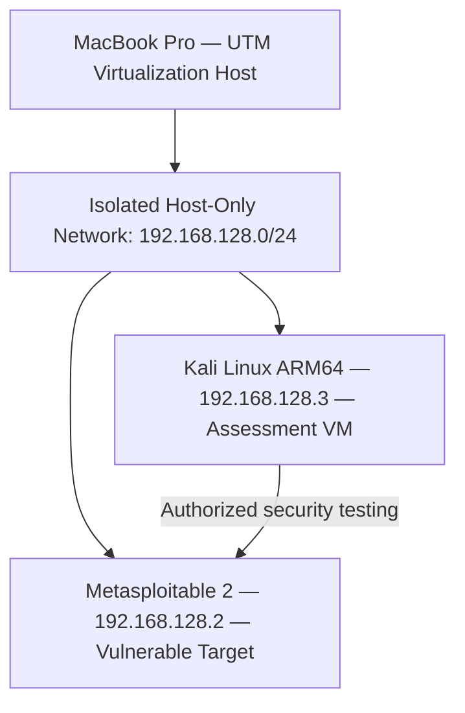

# Day 6 — Lab Network Diagram

This diagram represents the isolated UTM virtual network used for the authorized Security Fundamentals Mini Project.

## Network Details

| Component | Role | Address |
|---|---|---|
| MacBook Pro | UTM virtualization host | Host address not recorded |
| Kali Linux ARM64 | Assessment machine | 192.168.128.3 |
| Metasploitable 2 | Intentionally vulnerable target | 192.168.128.2 |
| Host-only network | Isolated lab subnet | 192.168.128.0/24 |

## Scope

Only the Metasploitable 2 VM was targeted. The lab was isolated from production systems.
